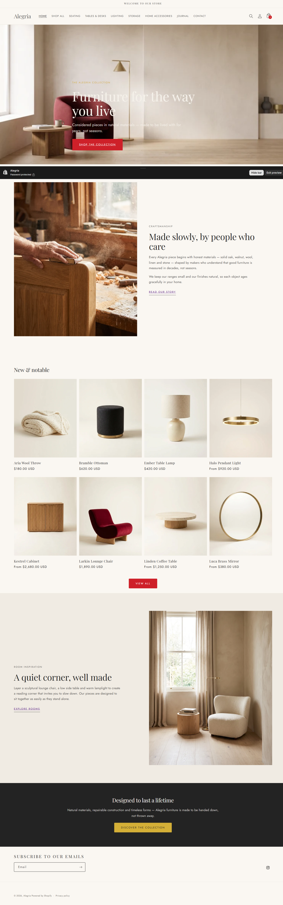
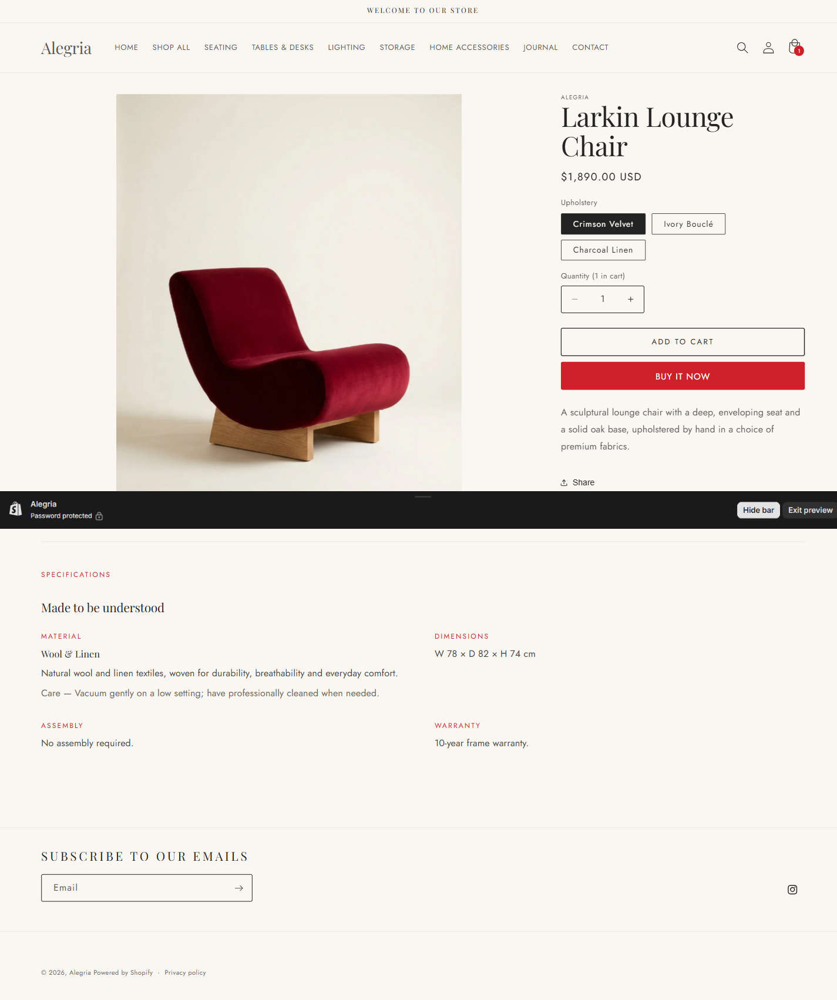
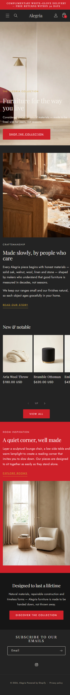
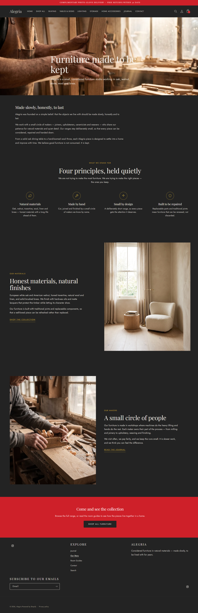
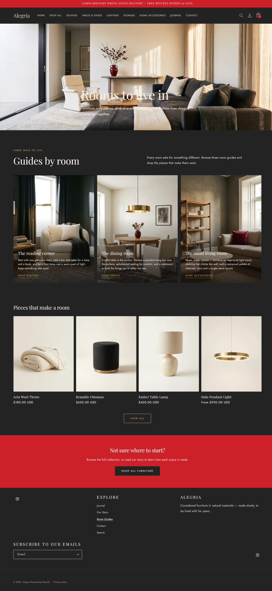

# Alegria — Shopify Furniture & Interiors Storefront

A **portfolio-only** Shopify storefront for **Alegria**, a fictional premium furniture and home-interiors brand. Built on **Shopify Online Store 2.0** (Dawn base) to demonstrate professional Shopify theme development: Liquid, JSON templates, custom sections, product variants, metafields & metaobjects, collection filtering, an Ajax cart, accessibility, SEO and performance.

**Live demo:** https://alegria-desoau8q.myshopify.com/ — *password-protected dev store; ask me for access.*
This is a fictional brand — there are **no real products, customers or payments** (checkout uses Shopify's test gateway).



---

## Highlights

- **Custom editorial hero** (`sections/alegria-hero.liquid`) — full-bleed image, optional eyebrow/heading/text, CTA, with height/position/overlay controls and a **position-aware scrim** that keeps white type legible over bright imagery.
- **Reusable editorial section** (`sections/alegria-editorial.liquid`) — split image/text, image side configurable.
- **Specifications section** (`sections/alegria-product-specs.liquid`) — renders product **metafields** and a linked **metaobject** (Material) on the product page, handling missing values gracefully.
- **16 products across 5 collections** with real options/variants, variant-aware pricing and images.
- **3-image product galleries** — a studio hero, a styled in-room lifestyle shot and a material detail shot per product.
- **Variant-specific images** — the gallery switches to the selected colour/finish (e.g. Larkin in Crimson Velvet / Ivory Bouclé / Charcoal Linen).
- **Shop by collection** section on the homepage, and product pages with specifications + shipping/care accordions.
- **Our Story & Room Guides** pages with dedicated section templates (hero, editorial, room cards).
- **Room inspiration** section — three large room cards (reading corner, dining room, small living room).
- **Collection banners** — an editorial banner image on every collection page.
- **Native collection filtering & sorting** (Shopify Search & Discovery) with a mobile filter drawer.
- **Ajax cart drawer** (Dawn) — add, update, remove, live count and subtotal.
- **Journal** blog with three editorial articles.
- **Values section** (`sections/alegria-values.liquid`) — brand promises with line icons.
- **Testimonials section** (`sections/alegria-testimonials.liquid`) — starred customer quotes.
- **Journal section** (`sections/alegria-journal.liquid`) — the latest posts pulled from the Journal blog.
- **Article pages** — on-brand typography plus a **"More from the Journal"** related-articles section.
- **Polished details:** a branded footer (Explore menu + brand statement), an on-brand 404 page, and a smooth card cross-fade on hover (lifestyle image, 1s).
- **Brand design system** — a charcoal-led palette (charcoal ≈60% / crimson ≈30% / gold ≈10%): Charcoal `#232323`, Crimson `#CE2029`, Metallic Gold `#D4AF37`; Playfair Display headings + Jost body.
- **AI-generated imagery** (Gemini) uploaded to Shopify Files.
- **Brand favicon + social share image**, plus branded **Contact**, **Blog listing** and **Collections** pages (each with an editorial hero).
- **Brand logo** — the Alegria ribbon-monogram lockup (transparent PNG) in the header, footer and password page, with a monogram-derived favicon.

| Product page | Mobile |
| --- | --- |
|  |  |

| Our Story | Room Guides |
| --- | --- |
|  |  |

## Catalog

**Collections:** Seating · Tables & Desks · Lighting · Storage · Home Accessories

| Collection | Products |
| --- | --- |
| Seating | Larkin Lounge Chair, Marlow 3-Seat Sofa, Ottoline Accent Chair, Bramble Ottoman |
| Tables & Desks | Oslo Dining Table, Linden Coffee Table, Wren Writing Desk |
| Lighting | Vane Floor Lamp, Halo Pendant Light, Ember Table Lamp |
| Storage | Rowan Shelving Unit, Kestrel Cabinet, Nook Sideboard |
| Home Accessories | Aria Wool Throw, Terra Stoneware Vase, Luca Brass Mirror |

Products use real Shopify variants (Upholstery / Size / Finish / Colour …) with variant-specific pricing.

## Structured content (metafields & metaobjects)

- **Metaobject `alegria_material`** (Title, Description, Care) — 5 reusable entries (Solid Oak, Walnut, Travertine, Wool & Linen, Brushed Brass).
- **Product metafields** (namespace `alegria`): `material` (metaobject reference), `dimensions`, `assembly`, `warranty`.
- See [`docs/setup-guide.md`](docs/setup-guide.md) for exact definitions and how to recreate them.

## Theme architecture

```
theme/
  layout/        theme.liquid (brand CSS injected after base.css)
  templates/     index.json, product.json, collection.json, blog.json, article.json, …
  sections/      alegria-hero, alegria-editorial, alegria-values, alegria-testimonials, alegria-journal, alegria-product-specs (+ Dawn sections)
  snippets/      Dawn snippets (+ quantity-input label fix)
  assets/        alegria.css (brand layer) + Dawn assets
  config/        settings_schema.json, settings_data.json (5 brand colour schemes)
  locales/       translations
docs/            setup guide, screenshots
scripts/         catalog tooling used to build the demo
PROJECT.md       chronological build log
```

## Tech stack

**Shopify Online Store 2.0** · **Liquid** · JSON templates · **JavaScript** (Dawn web components) · **HTML/CSS**. Theme base: **Dawn**. Tooling: **Shopify CLI 4.9.3** (`theme push/publish/check`).

## Local development

```bash
# requires Node.js and Shopify CLI
npm install -g @shopify/cli
shopify auth login --store alegria-desoau8q.myshopify.com
cd theme
shopify theme dev --store alegria-desoau8q.myshopify.com   # live local preview
shopify theme check                                       # lint
shopify theme push --theme "Alegria" --store alegria-desoau8q.myshopify.com
```

## Testing

- **Theme Check:** 0 errors (Dawn base warnings only).
- **axe-core:** homepage, collection and product pages **clean** (only the admin preview-bar iframe is flagged, which does not exist on the live store).
- **Lighthouse (mobile, live theme):** Accessibility **100** · SEO **92** · Best Practices **73** · Performance **63**.
  - Performance / Best Practices are dominated by **Shopify platform scripts** (Web Pixels, analytics, account) rather than the theme; the hero image is prioritised and below-the-fold images lazy-loaded.
- Verified: variant selection (price + availability), add-to-cart, collection filtering/sorting, navigation, journal, pages, 3-image galleries, responsive layout (no horizontal overflow at 390px).

## Known limitations

- Development store — storefront is **password-protected**; checkout uses Shopify's **test gateway** (no real payments).
  - On a **development store Shopify always serves its own default password page** to visitors; the theme's branded password page (`sections/alegria-password.liquid`) is only shown on a paid plan (or in the theme editor).
- Performance is bounded by Shopify's platform JavaScript.
- The header uses a **text wordmark** (the shop name in Playfair Display) rather than an image logo, to keep the typeface consistent with the brand.
- The storefront has no customer accounts content beyond Dawn defaults.

## Notes & disclaimers

- Fictional "Alegria" brand; all copy, prices and imagery are illustrative.
- Product imagery is **AI-generated** for the demo.
- The repository contains **no secrets or credentials**.
- Not affiliated with any real brand or business.
